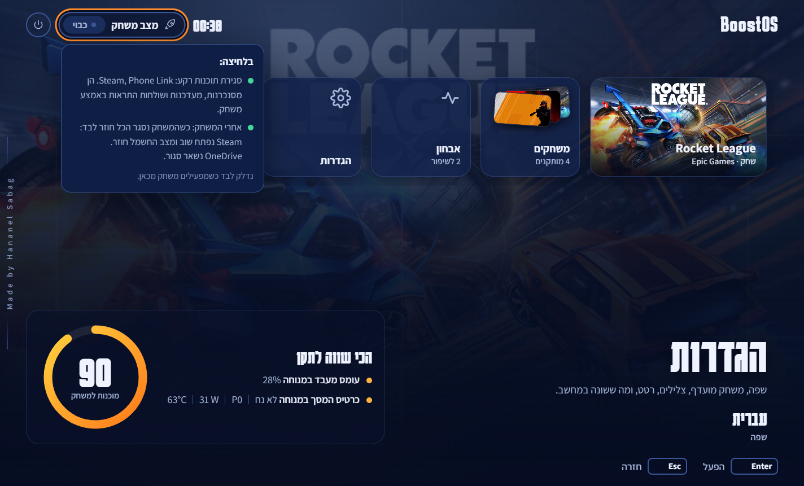
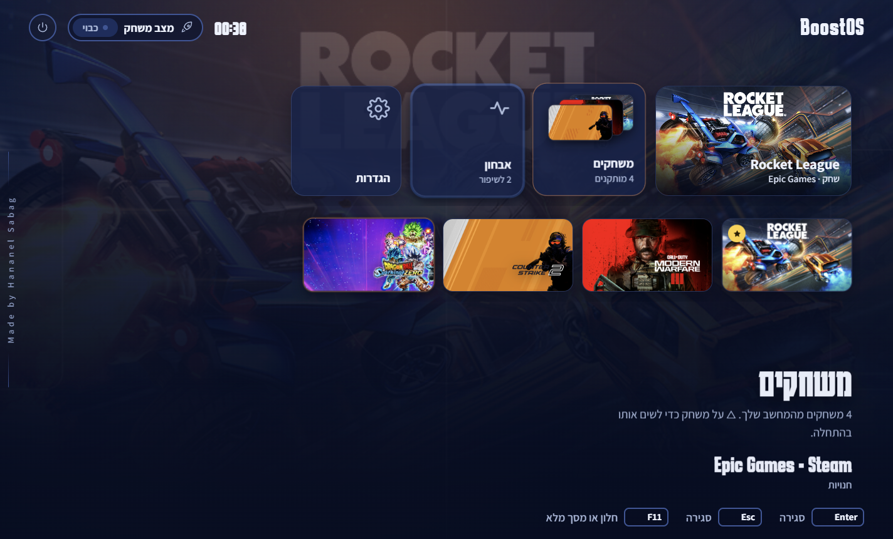
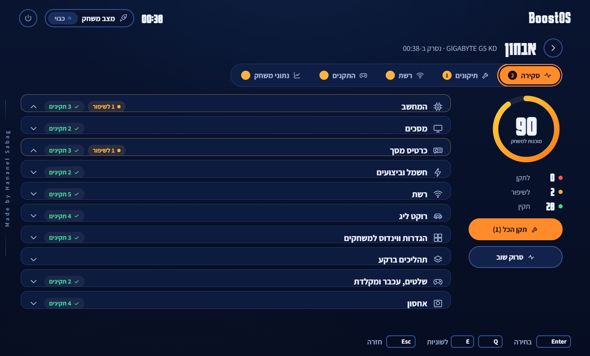
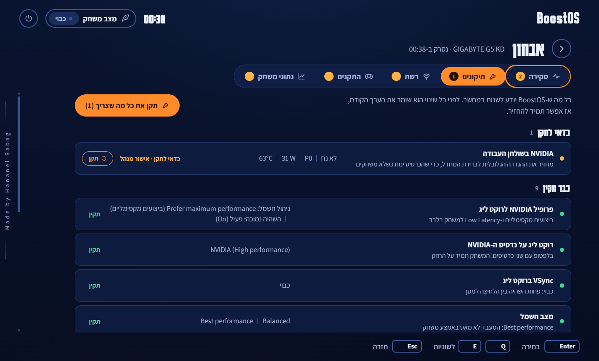
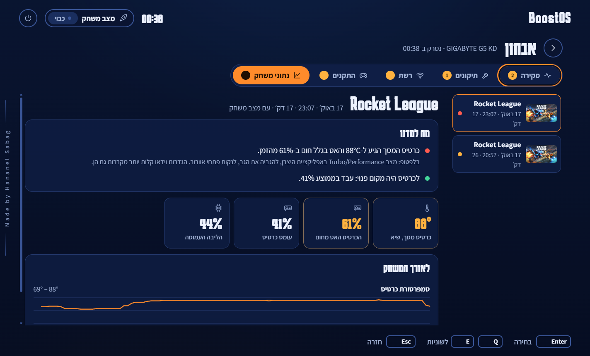

# BoostOS

**A console-style home screen for Windows that gets your PC ready to play, and puts it back afterwards.**

[](https://github.com/HananelSabag/BoostOS/actions/workflows/ci.yml)


[](LICENSE)



BoostOS opens full screen like a PlayStation or Xbox dashboard and is driven with a controller, the keyboard or a mouse.
Your favourite game sits on the first tile with its own artwork. Press it and BoostOS closes what would get in the way,
switches power to performance and starts the game through its own launcher. When you close the game, everything goes
back by itself and you get a short report on how the PC held up.

> Made by **Hananel Sabag**.

---

## What's inside

| | |
|---|---|
| **Favourite game** | The big first tile, with the game's real art (from the launchers' own local caches, nothing is downloaded). △ / Y on any game puts it first. |
| **Games** | A folder that unfolds a row of every installed game underneath it: Epic Games and Steam, found from the launchers' files. Up returns to the rail, Back closes the row. |
| **Game Mode** | One pill next to the power button. Focus shows what it will do; a press switches it. It closes background sync, updaters and phone extras (OneDrive, Steam unless the game is on Steam, Phone Link, Widgets, Teams, Copilot, Adobe) and sets *Best performance*. It turns on by itself when a game starts from BoostOS and is restored when the game closes, even after a crash. |
| **Diagnostics** | One screen with five tabs, switched with L1/R1 (LB/RB, Q/E): |
| ↳ Overview | The readiness score and ten areas of the PC. Areas with something to improve open by themselves; the rest fold to one line. |
| ↳ Fixes | Everything BoostOS can change, grouped into *worth fixing*, *changed by BoostOS* (with Undo), *already good* and *not needed here*. |
| ↳ Network | Router and internet pinged side by side, drawn live. It tells loss from a router that only limits pings, and finds spikes on a fixed beat. |
| ↳ Devices | What's plugged in, plus a controller test (a drawn controller that lights up, and a drift test that recommends a deadzone), a keyboard test (every key, and how many register at once) and a mouse test (polling rate, buttons, wheel). |
| ↳ Game data | Every recorded session: what it means in plain words first, then GPU heat and how often it slowed down, the CPU's real clock, router and internet ping during play, Wi-Fi signal, memory, and which other apps used the CPU. |
| **Rocket League video** | The game's own Video settings, read from its settings file and saved back to it while the game is closed. When the last session showed the GPU held back by heat, BoostOS suggests lighter settings. Everything it changes can be put back. |
| **Settings** | Language, favourite game, Game Mode on start, sounds, rumble, full screen, game data, and *Undo all fixes*. Exit asks first, and offers to just go to the desktop. |

| Games row | Diagnostics |
|---|---|
|  |  |
| **Fixes** | **Game data** |
|  |  |

## Safe with Easy Anti-Cheat

Rocket League requires Easy Anti-Cheat online since 28 April 2026. BoostOS is built so there is nothing for it to see:

- It never opens a handle to a game process, never reads its memory, and injects nothing.
- It finds running games from the kernel's process snapshot, and confirms one by its image path from the same snapshot
  (`NtQuerySystemInformation`, `SystemProcessIdInformation`): the information Task Manager shows, read without opening the process.
- Session reports use driver data (`nvidia-smi`), Windows' own CPU and clock counters, ping and the Wi-Fi API, never the game.
- It starts games only through Epic or Steam, so their anti-cheat starts with them.
- It reacts to the controller only while its own window has focus, so presses in the game never reach it.

Everything it changes is a Windows setting, a driver profile or a game's settings file: the same things you could change by hand.

## What a fix changes

| Fix | What changes | Admin |
|---|---|:-:|
| NVIDIA on the desktop | Global *Power management mode* back to the driver default, so the card rests outside games | ✓ |
| NVIDIA profile | Rocket League profile: *Prefer maximum performance* + *Low Latency Mode: On* (via NVAPI) | ✓ |
| Rocket League GPU | Graphics preference for `RocketLeague.exe` → *High performance* | |
| VSync | `UseVsync=False` in `TASystemSettings.ini` (backed up first) | |
| Power mode | Windows power mode → *Best performance* | |
| Windows Game Mode | Game Mode → on | |
| Windowed optimizations | *Optimizations for windowed games* → on | |
| Background recording | Game Bar *Record what happened* → off | |
| Wi-Fi power | Wireless adapter power saving on AC → *Maximum Performance* | |
| Wi-Fi roaming | Intel *Roaming Aggressiveness* → *Lowest* | ✓ |

Each fix stores the value it replaced in `%LOCALAPPDATA%\BoostOS\fixes.json`; *Undo* writes it back.
Admin fixes run in a second copy of BoostOS started elevated, so a batch asks for approval once.
What BoostOS deliberately leaves alone, because the effect is unproven or a trade-off: HAGS, MIMO power save, monitor overclocking, Windows security features.

## Design

- **The arena:** night navy under two floodlights that take the colour of the focused tile, with the focused game's art behind the home screen. Blue team, orange team, and boost yellow.
- **Readable where it counts:** every screen except Home dims the arena and puts text on solid cards.
- **The boost meter:** the readiness score is the round boost gauge from the Rocket League HUD.
- **Console motion:** a boot sequence, tiles that spring into focus with a light sweep, a games row that unfolds under its folder, tabs, dialogs, short Web Audio interface sounds and a light controller rumble. `prefers-reduced-motion` is honoured.
- **Free while you play:** animations use transform and opacity, loops pause when the page is hidden, and the host suspends the whole WebView2 once the window is minimized.
- **Type:** Karantina (scoreboard-style Hebrew display face) and Assistant, bundled so the app works offline.

## How it's built

```
src/BoostOS/
  Program.cs, MainForm.cs   WinForms host: fullscreen window, WebView2, message bridge, game watcher
  Core/                     models, settings, strings, Win32/WMI helpers, the handle-free process snapshot
  Diagnostics/              one class per scan area, run in parallel
  Network/NetTest.cs        live ping test and its analysis
  Game/                     game library, Game Mode, the session recorder and its probes
  Tuning/                   fixes with undo, NVIDIA profiles through NVAPI, Rocket League video settings
  wwwroot/                  the UI: vanilla HTML/CSS and ES modules, no framework (screens/, panels/)
tests/BoostOS.Tests/        xUnit tests for parsing, network analysis, reports, recovery, settings
tools/                      icon generator, standalone Wi-Fi tweak script
```

The page and the host talk through `chrome.webview.postMessage({ cmd })` and `{ type, data }` replies. Opened in a normal browser,
the UI falls back to a small fake host fed from `wwwroot/dev/*.sample.json`, which makes design work possible without the app.

## Build and run

Requires Windows 10/11, the [.NET 10 SDK](https://dotnet.microsoft.com/download) and the WebView2 runtime (part of Windows 11).

```
dotnet run --project src/BoostOS                 # full screen
dotnet run --project src/BoostOS -- --windowed   # in a window
dotnet test BoostOS.slnx
dotnet publish src/BoostOS -c Release -o publish
```

Headless modes, handy for checking a machine:

```
BoostOS.exe --scan-json scan.json [en]   # full diagnostics as JSON
BoostOS.exe --games-json games.json      # installed games, art, running game, Rocket League video settings
BoostOS.exe --net-json net.json 60       # 60-second network test with every sample
BoostOS.exe --record-json rec.json 40    # a 40-second session recording without a game: checks every probe
BoostOS.exe --nvidia-json nv.json        # raw NVIDIA profile fields, global profile included
```

## Things learned along the way

- **The global NVIDIA profile matters on a laptop.** On the test machine the global *Power management mode* was *Prefer maximum performance*, so the GPU sat at P0 drawing ~29 W at 63 °C on an idle desktop. Games keep their own profile; the desktop doesn't need full clocks.
- **Heat, not load, was the limit.** A recorded session showed the GPU at only ~45 % load but at its 87 °C target, slowing down from heat 60 % of the time. That's why sessions now record the CPU's real clock too, and why the video settings screen suggests lighter settings after a hot session.
- **A router can fake packet loss.** The home router used for testing answers a ~15 second burst of pings and then drops exactly one a second once the total passes ~7/s. The test runs at 2.5 pings/s per target, and the in-game probe at one a second.
- **NVAPI struct versions matter.** Newer NVAPI headers add a 64-bit member to `NVDRS_SETTING` (12,328 bytes); the driver tested here expects the older 12,320-byte layout. BoostOS tries both.
- **Measure before you look.** Idle CPU load is sampled before the scan starts, otherwise the scan measures itself.

## License

[MIT](LICENSE) © 2026 Hananel Sabag. Rocket League is a trademark of Psyonix; BoostOS is an independent project and isn't affiliated with Psyonix, Epic Games, Valve or NVIDIA.

---

## בעברית

BoostOS הוא מסך בית בסגנון קונסולה לווינדוס, שמכין את המחשב למשחק ומחזיר אותו למצב הרגיל אחרי.

- **משחק מועדף:** הריבוע הגדול הראשון, עם התמונה של המשחק. △ על כל משחק שם אותו בהתחלה.
- **משחקים:** תיקייה שנפרסת לשורה מתחת עם כל המשחקים המותקנים מ-Epic ומ-Steam. למעלה חוזרים, חזרה סוגרת.
- **מצב משחק:** כפתור קטן ליד כפתור היציאה. נדלק לבד כשמפעילים משחק, וכשהמשחק נסגר הכל חוזר לבד.
- **אבחון:** מסך אחד עם לשוניות: סקירה (מה תקין ומה לא), תיקונים, רשת, התקנים (בדיקת שלט, מקלדת ועכבר) ונתוני משחק.
- **נתוני משחק:** אחרי כל משחק: חום כרטיס המסך וכמה הוא האט, מהירות המעבד, פינג ו-Wi-Fi בזמן המשחק, ואיזה תוכנות עבדו ברקע. קודם במילים פשוטות, אחר כך המספרים.
- **הגדרות וידאו לרוקט ליג:** ההגדרות של המשחק עצמו, עם המלצות לפי מה שנמדד במחשב, ושמירה ישר לקובץ של המשחק.
- **בטוח עם האנטי-צ'יט:** BoostOS לא פותח את תהליך המשחק ולא נוגע בזיכרון שלו. הוא משנה רק הגדרות של ווינדוס, פרופיל בדרייבר וקובץ ההגדרות של המשחק, ואת כל השינויים אפשר להחזיר.
- **שפה:** עברית או אנגלית.

נבנה על ידי **חננאל סבג**. קוד פתוח ברישיון [MIT](LICENSE).
