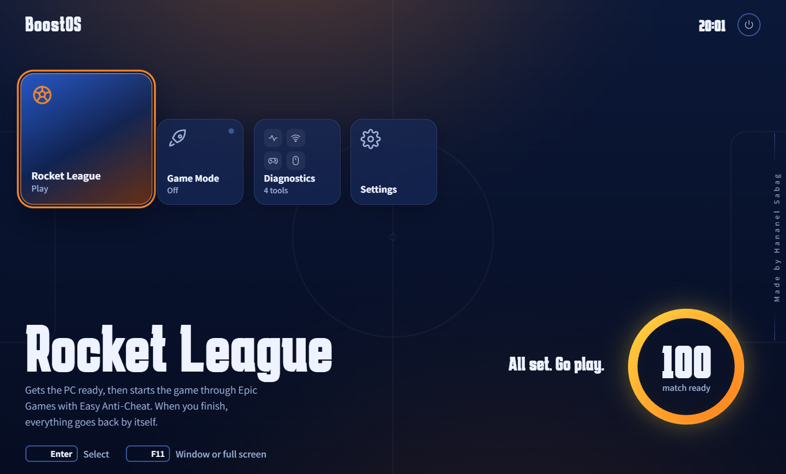
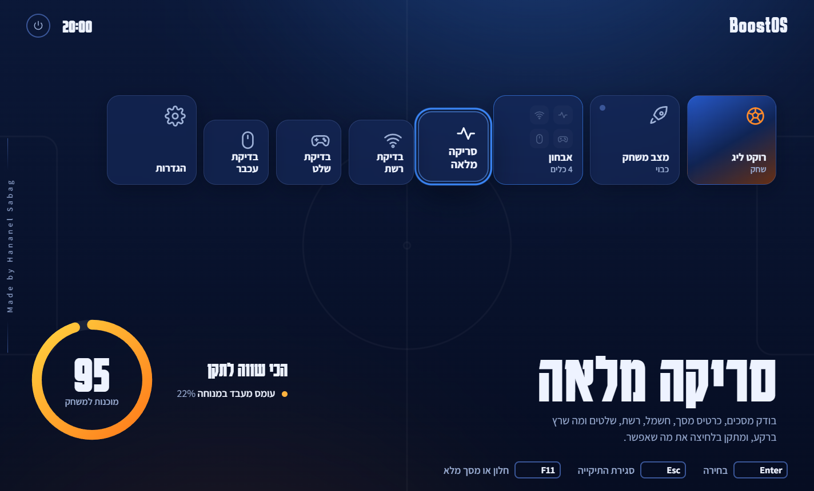
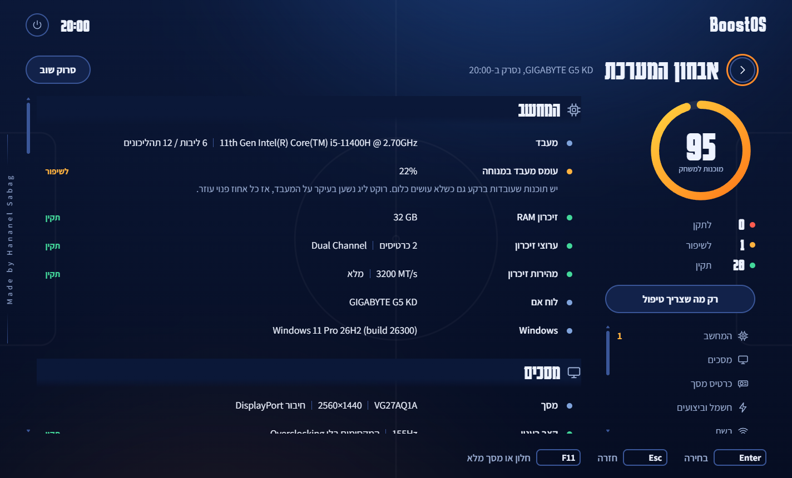
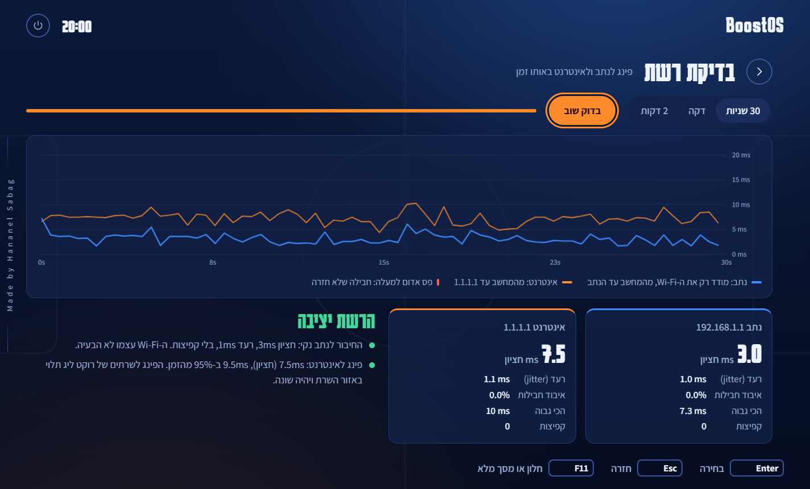
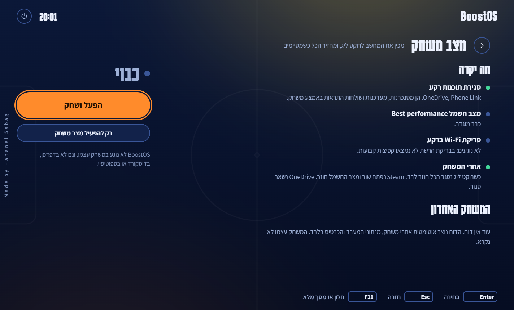
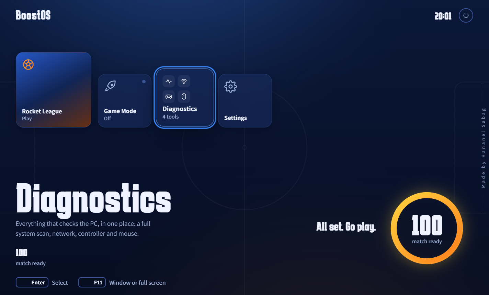
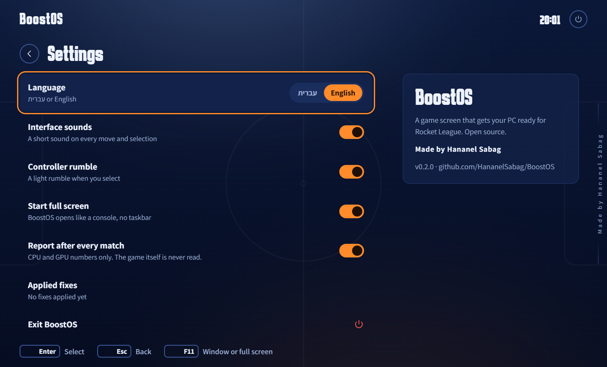

# BoostOS

**A console-style home screen for Windows that gets your PC ready for Rocket League, and puts it back afterwards.**

[](https://github.com/HananelSabag/BoostOS/actions/workflows/ci.yml)




BoostOS opens full screen like a PlayStation or Xbox dashboard and is driven with a controller, the keyboard or a mouse.
Press **Rocket League** and it closes what would get in the way mid-match, switches power to performance and starts the
game through its own launcher. When the match ends, everything goes back by itself and you get a short report on how the PC held up.

> Made by **Hananel Sabag**.

---

## What's inside

| | |
|---|---|
| **Play** | Turns on Game Mode, then starts Rocket League through Epic Games or Steam (with Easy Anti-Cheat). BoostOS minimizes and its page is suspended, so it costs nothing while you play. |
| **Game Mode** | Closes background sync, updaters and phone extras (OneDrive, Steam, Phone Link, Widgets, Teams, Copilot, Adobe) and sets *Best performance*. A snapshot on disk lets it restore even after a crash. Browsers, Discord, Spotify and your controller software are never touched. |
| **Diagnostics** | A folder that unfolds into four tools. |
| ↳ Full scan | Ten areas: PC, displays, graphics, power, network, Rocket League, Windows gaming settings, background apps, controllers, storage. Every problem BoostOS can fix has a **Fix** button, and every fix can be undone. |
| ↳ Network test | Router and internet pinged side by side, drawn live: blue is the Wi-Fi link, orange is the way out. It tells loss from a router that only limits pings, and finds spikes on a fixed beat (Windows' background Wi-Fi scans). |
| ↳ Controller test | Live sticks, triggers and buttons, plus a 3-second drift test that recommends a Controller Deadzone for Rocket League. |
| ↳ Mouse test | Polling rate from raw pointer updates. |
| **Match report** | After each match: GPU load, peak temperature, clocks, power, time the GPU was held back, and the busiest CPU core. It names the bottleneck and compares the match with the previous one. |
| **Settings** | Hebrew or English, interface sounds, controller rumble, start full screen, match reports, and *Undo all fixes*. |

| Diagnostics folder | Full scan |
|---|---|
|  |  |
| **Network test** | **Game Mode** |
|  |  |
| **Controller test** | **Settings** |
|  |  |

## Safe with Easy Anti-Cheat

Rocket League requires Easy Anti-Cheat online since 28 April 2026. BoostOS is built so there is nothing for it to see:

- It never opens a handle to the game process, never reads its memory, and injects nothing.
- It finds the game from the system's process snapshot only (`Process.GetProcessesByName`).
- Match reports use driver data (`nvidia-smi`) and Windows' own per-core CPU counters, not the game.
- It starts the game only through Epic or Steam, so Easy Anti-Cheat starts with it.
- It reacts to the controller only while its own window has focus, so presses in the game never reach it.

Everything it changes is a Windows setting, a driver profile or the game's settings file: the same things you could change by hand.

## What a fix changes

| Fix | What changes | Admin |
|---|---|:-:|
| Power mode | Windows power mode → *Best performance* | |
| Background recording | Game Bar *Record what happened* → off | |
| Windows Game Mode | Game Mode → on | |
| Windowed optimizations | *Optimizations for windowed games* → on | |
| Rocket League GPU | Graphics preference for `RocketLeague.exe` → *High performance* | |
| VSync | `UseVsync=False` in `TASystemSettings.ini` (backed up first) | |
| Wi-Fi power | Wireless adapter power saving on AC → *Maximum Performance* | |
| Wi-Fi roaming | Intel *Roaming Aggressiveness* → *Lowest* | ✓ |
| NVIDIA profile | Rocket League profile: *Prefer maximum performance* + *Low Latency Mode: On* (via NVAPI) | ✓ |

Each fix stores the value it replaced in `%LOCALAPPDATA%\BoostOS\fixes.json`; *Undo all fixes* writes them back.
Admin fixes run in a second copy of BoostOS started elevated, so a batch asks for approval once.
What BoostOS deliberately leaves alone, because the effect is unproven or a trade-off: HAGS, MIMO power save, monitor overclocking, Windows security features.

## Design

- **The arena:** night navy under two floodlights that take the colour of the focused tile. Blue team, orange team, and boost yellow.
- **The boost meter:** the readiness score is the round boost gauge from the Rocket League HUD, and it fills like a boost pickup at start-up.
- **Console motion:** a boot sequence, tiles that spring into focus with a light sweep, a folder that unfolds its tools, view transitions between screens, short Web Audio interface sounds and a light controller rumble. `prefers-reduced-motion` is honoured.
- **Free while you play:** animations use transform, opacity and filter only, every loop pauses when the page is hidden, and the host suspends the whole WebView2 once the window is minimized.
- **Type:** Karantina (scoreboard-style Hebrew display face) and Assistant, bundled so the app works offline.

## How it's built

```
src/BoostOS/
  Program.cs, MainForm.cs   WinForms host: fullscreen window, WebView2, message bridge, game watcher
  Core/                     models, settings, Hebrew/English strings, Win32 and WMI helpers
  Diagnostics/              one class per scan area, run in parallel
  Network/NetTest.cs        live ping test and its analysis
  Game/                     Game Mode (apply/restore) and the match recorder
  Tuning/                   fixes with undo, NVIDIA driver profile through NVAPI
  wwwroot/                  the UI: vanilla HTML/CSS and ES modules, no framework
tests/BoostOS.Tests/        xUnit tests for parsing, network analysis, reports, settings
tools/                      icon generator, standalone Wi-Fi tweak script
```

The page and the host talk through `chrome.webview.postMessage({ cmd })` and `{ type, data }` replies. Opened in a normal browser,
the UI falls back to a small fake host, which makes design work possible without the app (`wwwroot/dev/scan.sample.json` is
created with `BoostOS.exe --scan-json`).

## Build and run

Requires Windows 10/11, the [.NET 10 SDK](https://dotnet.microsoft.com/download) and the WebView2 runtime (part of Windows 11).

```
dotnet run --project src/BoostOS                 # full screen
dotnet run --project src/BoostOS -- --windowed   # in a window
dotnet test BoostOS.slnx
dotnet publish src/BoostOS -c Release -o publish
```

Headless modes, handy for checking a machine:

```
BoostOS.exe --scan-json scan.json [en]   # full diagnostics as JSON
BoostOS.exe --net-json net.json 60       # 60-second network test with every sample
BoostOS.exe --nvidia-json nv.json        # raw NVIDIA profile fields
```

## Things learned along the way

- **A router can fake packet loss.** The home router used for testing answers a ~15 second burst of pings and then drops exactly one a second once the total passes ~7/s. Real Wi-Fi loss comes in bursts, so the test now runs at 2.5 pings/s per target and recognizes the metronome pattern instead of reporting a problem.
- **NVAPI struct versions matter.** Newer NVAPI headers add a 64-bit member to `NVDRS_SETTING` (12,328 bytes); the driver tested here expects the older 12,320-byte layout. BoostOS tries both and reads the value offset from the size it settled on.
- **Measure before you look.** Idle CPU load is sampled before the scan starts, otherwise the scan measures itself.

---

## בעברית

BoostOS הוא מסך בית בסגנון קונסולה לווינדוס, שמכין את המחשב לרוקט ליג ומחזיר אותו למצב הרגיל אחרי המשחק.

- **רוקט ליג:** מפעיל מצב משחק ופותח את המשחק דרך Epic או Steam, יחד עם Easy Anti‑Cheat. בזמן המשחק BoostOS מוקטן ומוקפא, ולא לוקח משאבים.
- **מצב משחק:** סוגר תוכנות רקע (OneDrive, Steam, Phone Link ועוד) ומעביר את החשמל לביצועים. כשהמשחק נסגר, הכל חוזר לבד.
- **אבחון:** תיקייה עם ארבעה כלים: סריקה מלאה עם כפתור "תקן" לכל בעיה, בדיקת רשת, בדיקת שלט עם המלצה ל-deadzone, ובדיקת עכבר.
- **דוח משחק:** אחרי כל משחק מוצגים עומס, טמפרטורה ומהירות של כרטיס המסך, ומה הגביל את ה-FPS: המעבד או הכרטיס.
- **בטוח עם האנטי-צ'יט:** BoostOS לא נוגע בתהליך של המשחק ולא בזיכרון שלו. הוא משנה רק הגדרות של ווינדוס, פרופיל בדרייבר וקובץ ההגדרות של המשחק, ואת כל השינויים אפשר להחזיר בלחיצה אחת.
- **שפה:** עברית או אנגלית, לפי הבחירה בהגדרות.

נבנה על ידי **חננאל סבג**.
