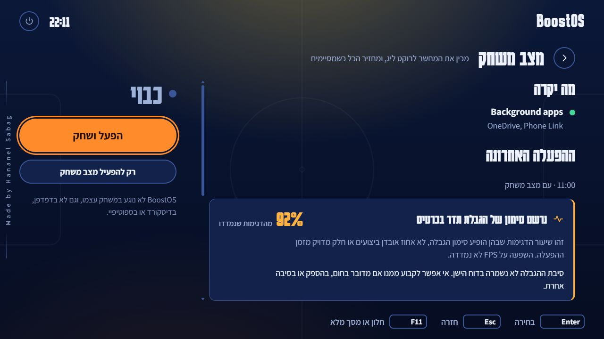
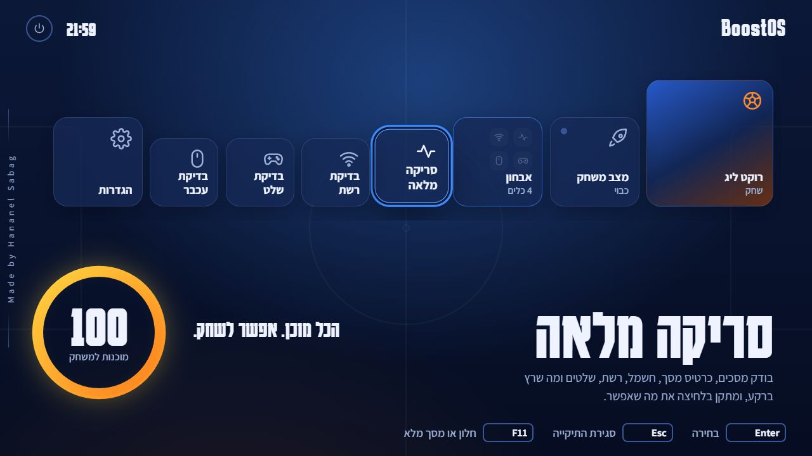

# סקירת BoostOS — 17 באוקטובר 2026

## המשך: שדרוג הקלטת סשן בגרסה 0.3.0

אחרי בדיקת הסשן השמור, בוצע שדרוג בקוד עצמו:

- דוח עם סימון הגבלה אינו מסתפק עוד בכיתוב המבוסס על ממוצע העומס. הסימון מקבל כרטיס בולט; בדוח ישן מוצג שסיבת ההגבלה לא נשמרה.
- בדגימות חדשות נשמרים זמן עם offset, זמן מונוטוני מתחילת ההפעלה, זהות GPU, מסכת סיבות ההגבלה המקורית וזמן קבלת נתון ה־GPU. נתונים חסרים נשמרים כ־null.
- המעבד נדגם בלי תלות בהצלחת תהליך NVIDIA. נתוני GPU שהתיישנו מעל חמש שניות אינם משמשים כנתונים עדכניים, וכרטיס נוסף אינו נכנס לאותה סדרה.
- עצירת ההקלטה ממתינה לדגימת המעבד, חוסמת עדכונים מאוחרים ושומרת קובץ מפורט מקומי. סגירה ושמירה חוזרות אינן יוצרות עותקים כפולים.
- האחוזים לחום, להספק ולהאטת חומרה מחושבים מתוך דגימות שסיבתן ידועה. הם אינם אחוז אובדן ביצועים, ויכולה להיות חפיפה בין הסיבות.
- נוספו גרפים נפרדים לטמפרטורה ולעומס, מספרי דגימות תקפות, מידע חסר והודעות על כישלון שמירה או הגעה למגבלת ההקלטה.
- הסיכום והגרף מדלגים על 20 השניות הראשונות לפי זמן, ולא לפי מספר שורות שהדרייבר החזיר. הפירוט כולל את ההתחלה. סיכומי הבדיקות הישנות נשארו תואמים.
- `%LOCALAPPDATA%\BoostOS\sessions` שומר עד 20 קבצים מפורטים של הפעלות חדשות. הזיכרון מוגבל ל־43,200 דגימות; הדוח מודיע על קיטוע. כתיבת קובצי המידע מתבצעת בהחלפה אטומית.

הסשן ההיסטורי לא שונה, ולא שוחזרו לו סיבות שאינן קיימות. צילום הבדיקה מדגים את התנהגות הממשק לערכי ההגבלה הישנים, עם תאריך דוגמה:

האימות העדכני עבר **95 מתוך 95 בדיקות**. נוספו 17 בדיקות לאיסוף, שימור סיבות, נתונים חסרים, תזמון, סגירה במקביל, תאימות לדוח ישן, serialization לממשק ושמירת קבצים מוגבלת. בוצעה גם קריאת NVIDIA חד־פעמית לקריאה בלבד: שש העמודות החדשות, כולל UUID ומסכת הסיבות, זמינות בדרייבר המקומי. נבדקו בתצוגת דפדפן הדוח הישן, דוח חדש עם סיבות, פערים בגרף ותרחיש CPU חסר/כשל שמירה, בעברית ובאנגלית.

עדיין אין מדידת FPS או זמני פריימים. דגימה כל כשתי שניות לא יכולה לתאר במדויק hitch קצר של כ־124ms, וכרטיס ה־GPU שנבחר הוא הראשון בזרם ולא הוכחה שזה הכרטיס שהמשחק משתמש בו במחשב עם כמה כרטיסי NVIDIA. עדיין נדרשת בדיקת משחק אמיתית לגרסה החדשה.

## הערכה כללית

BoostOS הוא יישום Windows עם מסך בית בסגנון קונסולה, כלי אבחון ושכבת הכנה למשחק. מבחינה טכנית הוא אינו מערכת הפעלה עצמאית. השילוב של C# עם WinForms ו־WebView2 מתאים לפרויקט הזה: גישה למערכת דרך המארח וממשק קל לפיתוח באמצעות HTML/CSS/JavaScript. אין סיבה להוסיף React או להחליף את מנוע הממשק כדי לפתור את התקלות שנמצאו.

יש בסיס טוב: חלוקה לתחומי אבחון, ממשק דו־לשוני, ניווט בשלט, עבודה מקומית, גיבויי הגדרות, בדיקות ו־CI. הפרויקט עדיין צריך הקשחה לפני שאפשר לסמוך על כל הבטחת שחזור או להסיק שהוא משפר FPS. ההבדל החשוב הוא בין ממשק מלוטש לבין מדידה שמוכיחה שהמשחק עצמו השתפר.

הסקירה כללה את המארח, מצב המשחק, תיקונים ו־undo, אבחון ורשת, רינדור וניווט, השלט והעכבר, רישום נתוני המערכת, NVAPI, כלי העזר, הבדיקות וה־CI. זו סקירת קוד ובדיקה של תרחישים נבחרים, ולא הוכחת היעדר תקלות בכל חומרה וגרסת Windows.

## מה תוקן בסבב הזה

| תחום | התקלה וההשפעה | התיקון |
|---|---|---|
| תיקיית האבחון | שינוי שפה הוסיף שוב מאזיני אירועים; פתיחה יכלה להתבצע כמה פעמים מאותו קליק | מאזין focus יחיד ומאזין click מוחלף, בלי הצטברות |
| פתיחת התיקייה | ארבעה כפתורים נוצרו והוסרו בכל פתיחה; פתיחה מהירה מחדש יכלה לפגוש כפתורים ישנים ומושבתים | הכפתורים קיימים מראש ומוסתרים כשהתיקייה סגורה; אין טיימר שמסיר עותק ישן |
| אנימציה ומיקוד | אנימציית `transform` עם מילוי קדימה התנגשה בהגדלת הכפתור הממוקד | reveal קצר עם `translate` נפרד, בלי להחזיק את ה־transform בסיום; הסדרה מתקצרת מכ־475ms לכ־246ms לפי ערכי ה־CSS |
| הפעלת אריח בעכבר | סגירת התיקייה ב־focus הזיזה את הכפתור לפני סיום הקליק | סגירה בעת ההפעלה עצמה; מעבר להגדרות נבדק בלחיצה אחת |
| עלות רינדור | blur גדול, שינוי צבע יורש שנמשך 700ms ו־layout כפוי בהחלפת תיאור | הוסר blur מהרקע ומהמעברים, הוסר tween גלובלי לצבע, והתיאור אינו מכריח layout כדי להתחיל אנימציה |
| חלון קטן | התיקייה הרחיבה את כל הגריד, ואריחים/מד מוכנות יצאו מהמסך | מסילת אריחים עם גלילה אופקית, גריד מוגבל לרוחב החלון, פריסה קומפקטית וגלילה בהגדרות |
| מד המוכנות | סריקה חדשה עם אותו ציון יכלה להשאיר `--` וטבעת ריקה | איפוס הציון השמור וביטול פריים קודם בזמן מעבר למצב סריקה |
| מסך השלט | לולאת ציור נוספת בתדירות המסך; בחלק משלטי Xbox רשימת כפתורים נבנתה בכל פריים | ציור דרך דגימת הניווט הקיימת ב־60Hz, שמירת פריסת הכפתורים לפי סוג השלט ומספר הכפתורים |
| מדידת drift | המלצת deadzone יכלה לעבור את הטווח 0–1 | התוצאה מוגבלת לטווח; החלפת שלט מבטלת מדידה של שלט קודם |
| בדיקת העכבר | חישוב `count * 4` הניח שטיימר 250ms תמיד מדויק | חישוב לפי הזמן שחלף בפועל וספירת אירועים מאוחדים כשזמינים; הוצג במפורש שמדובר בהערכה |
| סאונד | חזרה לחלון יכלה לחדש AudioContext גם בלי צליל | המנוע מתחדש רק לצורך צליל, מושעה כשהצלילים כבויים, וצומתי צליל מנותקים בסיום |
| פעולות ושגיאות | undo כושל הוצג כהצלחה; שגיאות יכלו להשאיר כפתורים במצב ממתין | מוצגת שגיאת הפעולה, ממתינים לסיום undo ונפתח נתיב ניסיון חוזר לסריקה |
| שפה בזמן סריקה | תוצאת סריקה מהשפה הישנה יכלה להתקבל לאחר החלפה | ממתינים לסיום הסריקה הישנה ואז מבקשים סריקה חדשה |
| שחזור מצב משחק | כישלון כתיבת דוח מנע שחזור; כישלון שחזור מחק את קובץ ההתאוששות | פעולת הדוח מבודדת מהשחזור; רק פריטים ששוחזרו נמחקים, והשאר נשמרים לניסיון חוזר |
| התאוששות | אחרי קריסה וסגירת המשחק לא היה מסלול שחזור אוטומטי בפתיחה הבאה | שחזור בהפעלה כשאין תהליך Rocket League פעיל; קובצי snapshot מוחלפים באופן אטומי והכוונה נשמרת לפני שינוי מצב המשחק |
| השקה ופעולות מקבילות | כישלון הפעלה השאיר מצב משחק חדש פעיל; פעולות שינוי התחרו זו בזו | rollback כשמפעיל המשחק נכשל, תוך שימור מצב ידני קודם; שער אסינכרוני משותף לפעולות שינוי באותו חלון |
| Wi-Fi במצב משחק | קפיצות מחזוריות שימשו בסיס לכיבוי אוטומטי של סריקות רשת | הוסרה פעולת הרשת האוטומטית: דפוס מחזורי לבדו אינו מוכיח מה גרם לקפיצה; נשאר שחזור לגיבויים ישנים |
| בדיקת רשת | אובדן בנתב או דפוס מחזורי הסתיר אובדן באינטרנט; קפיצות באינטרנט נשארו ירוקות | כל יעד נבחן בנפרד, אפס נתונים/אפס תשובות אינם תקין, וקפיצות ו־jitter באינטרנט מקבלים אזהרה |
| תזמון פינג | המשך מדידה יכול היה להמתין לתהליכון הממשק | המשכי async במדידה אינם חוזרים להקשר הממשק; עדיין אין כאן דיוק חומרתי של תת־מילישנייה |
| תהליכי עזר | stderr לא נוקז, קוד יציאה לא נבדק, ו־timeout לא סגר בהכרח צאצאים | שני הזרמים מנוקזים במקביל, כישלון מחזיר `null`, וב־timeout נסגר עץ התהליך |
| תיקוני Wi-Fi | undo השתמש בתוכנית החשמל או בכרטיס הנוכחיים במקום במקוריים | נשמר מזהה היעד; undo מחזיר אליו, ושינוי יעד נוסף נחסם כל עוד הגיבוי קיים |
| גיבויי Wi-Fi ישנים | ערך מספרי ישן אינו מכיל זהות יעד | התיקון נכשל במפורש ושומר את הגיבוי, במקום לנחש לאיזה יעד לכתוב |
| PowerShell | שגיאה לא מסיימת יכלה להסתיים ב־`ok` ולהירשם כהצלחה | שגיאות מסיימות, איתור כרטיס לפי GUID ותוצאה מובנית שנבדקת |
| VSync | undo של מפתח שלא היה קיים לא הסיר את המפתח שנוסף | הוסרה השורה שנוספה, תוך שמירה על שורות אחרות |
| NVIDIA undo | ב־session חדש כתיבת undo השתמשה תמיד במבנה החדש, גם בדרייבר שדורש מבנה ישן | fallback לשני גדלי המבנה גם בכתיבה, ורק עבור שגיאת גרסה לא תואמת |
| אחסון | כל MediaType שאינו HDD הוצג כ־SSD | SSD מזוהה רק בערך המתאים; מידע לא זמין נשאר מידע לא ידוע |
| דוח מערכת | אחוז דגימות מוגבלות יכול היה לעבור 100% | מונה ומכנה משתמשים באותה קבוצת דגימות GPU תקפות |
| אמינות הטקסט | נטען שהכלי מזהה בוודאות ספק תקול או את הגורם שהגביל FPS | הטקסט מבחין בין תצפית להשערה; הדוח נקרא דוח הפעלה ומסביר שאין מדידת FPS |

הזמנים בטבלת האנימציה הם משכי האנימציות המוגדרים, לא תוצאת benchmark של FPS בממשק.

## צבעים ועיצוב

הכיוון הקיים מוצלח: רקע כחול כהה עם טקסט בהיר, כתום לפעולה, צהוב למוכנות וכחול לכלי אבחון. אלה צבעים שמתקשרים היטב לרוקט ליג ויוצרים הבחנה בין אזורים. נשמרו הצבעים, הטיפוגרפיה והאופי הקונסולרי.

השיפורים הבאים שכדאי לבחון עם שימוש אמיתי:

- להשאיר צהוב למד המוכנות וכתום לפעולה העיקרית, כדי שלא כל דבר ידרוש תשומת לב באותה עוצמה.
- להקטין כותרות ענק במצב שולחני צפוף ולהשאיר אותן במצב סלון. כיום אותה שפה חזותית משרתת שני מרחקי צפייה שונים.
- להציג לצד הציון גם כמה בדיקות לא הצליחו וכמה מבוססות על הערכה. `100` מרגיש כיום כמו אישור ביצועים מלא, אף שהחישוב רק מפחית נקודות על אזהרות שנמצאו.
- להבחין בצורה ברורה בין תיקון קבוע, פעולה זמנית ובדיקה לקריאה בלבד. זה מידע שעוזר לבחור פעולה, ולא פרט מימוש.
- להציג לפעולות ארוכות מצב ממתין ברמת כל המסך, במיוחד בהפעלת מצב משחק ובהשקה. הסריאליזציה מונעת חלק מהתחרות, אבל עדיין אפשר לשלוח בקשות חוזרות לתור.

הצילום מציג את הממשק החדש עם דוח דוגמה קיים. הציון והנתונים בו אינם תוצאת סריקה חדשה של המחשב.

## העבודה החשובה שנותרה

| עדיפות | מיקום | למה זה חשוב ומה לשנות |
|---|---|---|
| גבוהה | `Tuning/Fixes.cs` — `ApplyHere` ומימושי Apply | בתיקונים הקבועים השינוי עדיין מתבצע לפני שמירת הגיבוי החדש. קריסה, כשל דיסק או הצלחת כתיבה ואחריה כישלון refresh יכולים להשאיר שינוי לא מתועד. לפצל capture/apply/verify, לשמור intent לפני mutation ולבדוק rollback בכשל חלקי. החלפה אטומית של הקובץ מונעת קובץ קטוע, אך אינה פותרת את חלון הזמן הזה. |
| גבוהה | `Tuning/Fixes.cs` — `rl-gpu-pref`, `rl-vsync`, `power-overlay` | undo של GPU/INI עדיין מאתר מחדש את התקנת המשחק במקום לשמור נתיב מקור; undo של power-overlay אינו בודק קוד הצלחה. לשמור את הנתיב וזהות ההגדרה ולאשר את ההחזרה לפני הסרת הרשומה. |
| בינונית | `Game/MatchRecorder.cs` | הערבוב בין כרטיסים תוקן ב־0.3.0 באמצעות זהות קבועה לכל סשן. עדיין כדאי לקשור את ה־UUID לכרטיס שבו המשחק מציג או לאפשר בחירה מפורשת במחשב עם כמה כרטיסי NVIDIA. |
| בינונית | `Diagnostics/NetworkCheck.cs` — `FindActiveLink` | נבחר הכרטיס הראשון עם gateway, ולא בהכרח המסלול ש־Windows בוחר ליעד הבדיקה. בהמשך נבחר בנפרד כרטיס Wi-Fi ראשון. במחשב עם VPN/כמה כרטיסים צריך לעקוב אחרי המסלול ליעד ולשמור על אותה זהות לאורך הבדיקה. |
| בינונית | `Diagnostics/NetworkCheck.cs` | פירוק טקסט `netsh` ושמות מאפיינים באנגלית תלויים בשפת Windows. עדיף API/ערכי RegistryKeyword או פלט מובנה; לבדוק גם מערכת בשפה שונה. |
| בינונית | `Core/Wmi.cs`, `Diagnostics/Scanner.cs` | שאילתות WMI אינן מוגבלות בזמן ואובייקטים לא מנוקים באופן עקבי; הסריקה ממתינה לכולם. להחזיר נתונים מנוהלים, לנקות משאבים, ולהוסיף timeout/cancellation ותוצאת בדיקה חלקית. |
| בינונית | `Diagnostics/Scanner.cs`, `SystemCheck.cs` | ציון יכול להיות 100 למרות נתונים חסרים. מספר מודולי RAM אינו הוכחה ל־Dual Channel. להפריד בין מה שנמדד, מה שלא נקרא ומה שהוסק; לא להפחית נקודות על הנחת ערוץ לא מבוססת. |
| בינונית | `tools/wifi-tweaks.ps1` | Apply חוזר שומר גיבוי שכבר מכיל את השינוי; Revert מהאחרון אינו בהכרח מחזיר למקור. הגיבוי גם לא קושר לערוץ/כרטיס מקורי. לשמור גיבוי ראשון לפי GUID ולבדוק חזרה פעמיים. הסקריפט לא הורץ בסקירה. |
| בינונית | ריבוי מופעי יישום ותהליך elevated | השער החדש מגן על אותו חלון בלבד. שני מופעי BoostOS, או helper שנמשך מעבר ל־timeout, עדיין יכולים להתחרות על אותם קבצים/הגדרות. להוסיף בעלות בין תהליכים ולהגדיר מדיניות timeout/השלמת helper. |
| נמוכה | `Tuning/Nvidia.cs` — lifecycle | לנקות session גם כש־Load נכשל; לבדוק איזון Initialize/Unload וקריאה של ערכים אפקטיביים כשאין פרופיל ייעודי. עדיין נדרשת בדיקת קריאה/כתיבה אמיתית על הדרייבר. |

הממצא החשוב ביותר להמשך הוא הטרנזקציה של התיקונים הקבועים. אין להסתפק בכך שקיים `fixes.json`: צריך להוכיח ששום כתיבה לא יכולה להצליח בלי שנתיב שחזור כבר נשמר.

## עד כמה הכלים יעילים

סריקת תצורה, בדיקת שלט, ניטור טמפרטורה והשוואת פינגים יכולים לחסוך עבודת אבחון ידנית. סגירת תוכנות רקע והחלפת מצב חשמל יכולות לעזור כשיש עומס או הגבלה מתאימה, אבל התועלת תלויה במחשב ובמצב ההתחלתי. החלפת מנוע הממשק לא תתקן צוואר בקבוק במשחק אם הממשק כבר מושעה.

כדי להוכיח שיפור, כדאי להריץ כמה סבבים מתחלפים של אותו replay/תרחיש, באותה רזולוציה, הגבלת FPS, מטען ופרופיל קירור, עם ובלי BoostOS. להשוות חציון וזנב של זמני פריימים, P95/P99, ופריימים שחורגים מתקציב התצוגה. ממוצע FPS לבדו יכול להסתיר גמגומים.

ללאג רשת, להשוות גם לגרפים של Rocket League ולבדיקת כבל: ICMP ל־1.1.1.1 אינו אותו מסלול/פרוטוקול כמו החיבור לשרת המשחק. להשהיית קלט, מדידת אירועי עכבר בממשק אינה מדידת זמן מהיד עד המסך.

## מה אומת

- מצב התחלתי: `main`, commit `d377da2`, קבצים נקיים ושני commits קיימים; המאגר `HananelSabag/BoostOS`.
- הבדיקה המקורית עברה 24 בדיקות. אחרי השינויים `dotnet test BoostOS.slnx -c Release --no-restore` עבר **78 מתוך 78**, ללא בדיקות מדולגות.
- הבדיקות החדשות מכסות אובדן/קפיצות ברשת, subprocess שנכשל/נתקע/ממלא stderr, החזרת הגדרות ליעד הנכון, שמירת נתוני undo בכשל, קובצי התאוששות, הסרת מפתח INI ומבני NVAPI באמצעות driver מדומה. הן לא שינו הגדרות מערכת.
- `node --check` עבר לכל מודולי JavaScript.
- בניית Release ו־`dotnet publish` הצליחו. גם אזהרת ה־WPF/WindowsBase של פרויקט הבדיקות הוסרה. נשארת הודעת מידע של SDK Preview המותקן במחשב.
- בדיקת דפדפן עם fake host: פתיחה/סגירה חוזרת של אבחון, ארבעה כפתורים יחידים ופעילים, Enter/Escape, החלפת עברית/אנגלית וחזרה, סריקה חוזרת עם אותו ציון, כניסה להגדרות מתוך תיקייה פתוחה ופריסה ב־1280×720 וב־1000×640. בחלון הקטן המסילה נגללת אופקית והתוכן מוגבל לרוחב החלון.
- ה־CI הקיים במאגר עבר לפני השינויים. השינויים של הסבב הזה מקומיים ולא נדחפו לגיט; לכן אין לייחס להם את תוצאת ה־CI הישנה.

לא הורץ משחק, לא הופעלו תיקונים ב־Windows, ולא נבדקו כתיבת NVIDIA בפועל, UAC, החזרה אחרי סשן משחק אמיתי או מדידת FPS חדשה. זיהוי בקר בדפדפן אינו בדיקת רטט/דיוק מדידת drift עם שלט פיזי.

## המשכיות העבודה עם Claude

השיחה הרלוונטית האחרונה ביקשה ממשק קונסולה מלוטש, תיקיית אבחון, עברית/אנגלית, בדיקות ופרסום בגיט. הבקשה האחרונה של MIT ופרסום הושלמה. כתיבה ל־NVIDIA, דוח אחרי סגירה אמיתית של המשחק, וסאונד/רטט בשלט פיזי הוזכרו אז כלא מאומתים. לא מוצגות כאן מדידות ה־CPU מהשיחה הקודמת כמדידות חדשות.

## מקורות טכניים לבדיקות נוספות

- [NVIDIA nvidia-smi](https://docs.nvidia.com/deploy/nvidia-smi/index.html) — בחירת GPU ושאילתות ניטור.
- [NVAPI headers](https://github.com/NVIDIA/nvapi/blob/main/nvapi.h) — גרסאות מבנה והגדרות DRS.
- [Microsoft Timer.Dispose](https://learn.microsoft.com/en-us/dotnet/api/system.threading.timer.dispose) — callbacks שכבר נמצאים בתור.
- [Microsoft RedirectStandardError](https://learn.microsoft.com/en-us/dotnet/api/system.diagnostics.processstartinfo.redirectstandarderror?view=net-10.0) — חסימה כשלא מנקזים זרמים.
- [PresentMon](https://github.com/GameTechDev/PresentMon) — מדידת זמני פריימים. לא הותקן ולא הורץ בסקירה.
